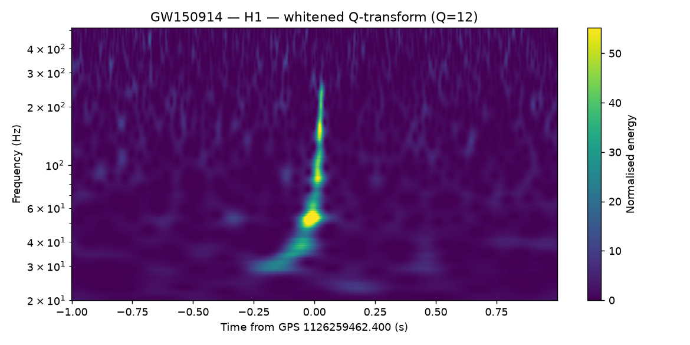

# gw-workflow

A [Pegasus WMS](https://pegasus.isi.edu/) workflow that independently reproduces
the **GWTC-1 binary black hole detections** from publicly released
[GWOSC](https://gwosc.org) strain data, and validates the recovered
signal-to-noise ratio, chirp mass and merger time against the published values.

Design and constraints: **[SPEC.md](SPEC.md)**. Sourcing rules (binding):
**[CLAUDE.md](CLAUDE.md)**. Reference material and per-event published values:
**[references/](references/)**.

> ### What this workflow does not establish
>
> **No statistical significance.** No false-alarm rate, no inverse FAR, no sigma
> value. Those come from time-shifting an entire observing run (`T_b = T²/δ`;
> ~15 days of coincident data for 5σ, 608,000 equivalent years of background for
> GW150914). A 4096 s segment cannot produce a background estimate, so the
> quantity is not merely unreported — it is not computable from this input.
>
> **Recovering a signal at a known time is not a detection** in the sense the
> published papers mean. This is a targeted reanalysis at catalogue times; it
> cannot discover anything. Every number is a point estimate from the
> best-matching template, not a posterior.

## Pipeline

```
                          ┌─────────────────────────────────────────────┐
GWOSC ──> fetch_strain ──> check_quality ──> condition_strain ──┬──> spectrogram
          (per event,                        (decimate, PSD,    │
           per detector)                      gate, off-source) │
                                                               ▼
                                            bank_psd  (fan-in: harmonic-mean PSD)
                                                               │
                                          bank_row x N_q  (one per mass ratio)
                                                               │
                                           merge_bank  (concat + B6 gate)
                                                               │
                                        ┌──────────────────────┴───────────┐
                                        ▼                                  ▼
                              matched_filter                     matched_filter
                              (analysis segment)                 (--dataset offsource/*)
                                        │                                  │
                                  coincidence                        coincidence
                                        │                                  │
                               estimate_params                    control_offsource ─┐
                                        │                                            │
                                 validate_event ────────────────> aggregate_report <─┤
                                                                                     │
                                                       control_injection ────────────┘
```

| Step | What it does | Source |
|---|---|---|
| `fetch_strain` | GWOSC event API → GPS time and the 4096 s / 4 kHz HDF5 URL | SPEC D1–D3, D8 |
| `check_quality` | DQ + injection bitmasks and NaN gate for the analysis span | SoftwareX §3.2 |
| `condition_strain` | decimate to 2048 Hz, high-pass, median PSD, inverse-PSD truncation, Tukey gating, off-source spans | Usman §3.2–3.3, SoftwareX §2.2 |
| `bank_psd` | harmonic-mean PSD over every conditioned segment, for placement | Usman §3.1 eq. 7 |
| `bank_row` | one constant-mass-ratio row of the bank; rows are independent | Usman §3.1 |
| `merge_bank` | concatenate the rows, gate the search on B6 adequacy | SPEC B6 |
| `matched_filter` | eq. (1)–(2), threshold + 1 s clustering; also drives the null test | Usman §2, §3.3 |
| `coincidence` | exact-template, 15 ms coincidence; 10 s final clustering | Usman §3.5–3.6 |
| `estimate_params` | detector-frame chirp mass, merger time, network SNR | SPEC M10 |
| `spectrogram` | whitened constant-Q transform | SPEC V4 |
| `validate_event` | compare against GWTC-1 with explicit criteria | SPEC §6.1–6.3 |
| `control_offsource` | V5a null test (**hard gate**) | SPEC V5a |
| `control_injection` | V5b known-parameter recovery (**hard gate**) | SPEC V5b |
| `aggregate_report` | one report across every event and control | SPEC §5.1, §6.6 |

## Directory structure

```
gw-workflow/
├── workflow_generator.py        generates all five catalogs + the DAG
├── bin/
│   ├── gwlib.py                 shared signal-processing core (support file)
│   ├── fetch_strain.py          … one wrapper per pipeline step
│   └── aggregate_report.py
├── Apptainer/
│   └── GW_Container.def         Ubuntu 24.04 + numpy/scipy/h5py/matplotlib/PyCBC
├── references/                  the four papers, SUMMARY.md, gwtc1_reference.json
├── tools/cc_usage_log.py        session token/cost logger (not part of the DAG)
├── run_manual.sh                run every step locally before submitting
├── SPEC.md                      constraints, non-constraints, validation criteria
├── CLAUDE.md                    sourcing rules
└── README.md
```

## Prerequisites

- Pegasus WMS ≥ 5.0 and HTCondor ≥ 10.2
- Apptainer (the workflow runs entirely in one container)
- Python 3.12 with `numpy`, `scipy`, `h5py`, `matplotlib`, `requests` on the
  submit host (for `run_manual.sh` and the generator)
- Network access to `gwosc.org`

## Quick start

### 1. Build the container

```bash
apptainer build --ignore-fakeroot-command GW_Container.sif Apptainer/GW_Container.def
apptainer inspect GW_Container.sif          # confirm it is not empty
```

`--ignore-fakeroot-command` is required for an unprivileged build. **Never use
`--fakeroot`** — it produces an empty container while reporting success.

The build fails deliberately if the default approximant is unusable: without it
the workflow falls back to a restricted post-Newtonian inspiral and every result
is marked `INVALID_FALLBACK_WAVEFORM` (SPEC M2).

**The default approximant is `IMRPhenomD`, not `SEOBNRv4_ROM`.** SEOBNRv4_ROM is
what GWTC-1's PyCBC bank used above 4 M☉ and remains selectable via
`--approximant`, but LALSuite ≥ 7.25 resolves its interpolation grids from
`$LAL_DATA_PATH`, and those ship in a separate multi-GB data release rather than
the pip wheel. IMRPhenomD is fully analytic, needs no data files, and is a
complete inspiral-merger-ringdown aligned-spin model. Every bank job probes the
approximant once and fails fast rather than silently degrading every template.

**The bank is built in three stages, not one job.** Placement at fixed mass
ratio never consults another row, so the rows fan out. Measured on real
GW150914 PSDs, the default bank is 3,453 templates and takes **28 min 56 s**
on one core; the six rows cost 4.6–5.3 min each, so fanned out the bank costs
about **5½ minutes of wall clock** instead of 29 in front of every filter job.
The PSD is split into its own job so each row stages one ~4 MB spectrum rather
than every conditioned segment (~30 MB × 14) once per row. `bin/build_bank.py`
still builds the whole bank serially for hand runs; both paths call the same
placement code in `bin/gwlib.py` and were checked to produce bit-identical
template sets.

### 2. Smoke-test locally

```bash
./run_manual.sh --offline      # synthetic data, no network — verifies the plumbing
./run_manual.sh                # fetches GW150914 from GWOSC
```

`--offline` synthesizes two GWOSC-shaped files carrying one coherent injection at
GW150914's published detector-frame parameters, so the whole chain — including
the PASS branch of `validate_event` and both hard gates — is exercised without
network access. It verifies the plumbing, not the physics.

Step 0 re-runs the core numerical invariants, including the two that caught real
bugs during development:

| Invariant | Why it exists |
|---|---|
| zero-noise self-filter peak `= sqrt(<h\|h>)` | a two-`irfft` SNR construction is exactly 2× too large |
| inverse-PSD truncation preserves the in-band level | truncating `1/S` instead of `1/√S` left the PSD ~700× low, inflating every SNR |

### 3. Generate and submit

```bash
./workflow_generator.py                        # Tier A (7 events), H1+L1 → 287 jobs
pegasus-plan --submit -s condorpool -o local workflow.yml
pegasus-status <run-dir>
pegasus-analyzer <run-dir>
```

## Verified result

This workflow has been run against real GWOSC data. Full record and artifacts in
**[validation/](validation/)**.

| GW150914 (Tier A) | Recovered | Published | Agreement |
|---|---:|---:|---|
| Network SNR | 23.614 | 23.6 | **+0.1%** |
| ℳ detector-frame (M☉) | 31.926 | 31.174 | +2.4%, inside the 90% interval |
| H1–L1 delay | 6.836 ms, L1 first | 6.9 +0.5 −0.4 ms, L1 first | **0.064 ms** |
| Merger time | — | published event GPS | within 21 ms |

Verdict **PASS**: all 9 criteria, plus both hard gates — 5 real off-source spans
produced zero coincident candidates, and 5 injections across ℳ_det 26–38 were all
recovered. The bank was restricted to ℳ_det 25–40 for run time; a full 5–60 bank
is needed for the whole event set.



## Event selection

Detector-frame chirp mass is `ℳ_source × (1+z)`; both columns come from GWTC-1
Table III, not from this workflow.

| Tier | Event | ℳ_det (M☉) | f_ISCO (Hz) | Published SNR | Note |
|---|---|---:|---:|---:|---|
| A | GW150914 | 31.2 | 61 | 23.6 | |
| A | GW151226 | 9.7 | 189 | 13.1 | |
| A | GW170104 | 25.7 | 72 | 13.0 | |
| A | GW170608 | 8.5 | 221 | 15.4 | |
| A | GW170809 | 29.9 | 62 | 12.2 | |
| A | GW170814 | 27.0 | 70 | 16.3 | |
| A | GW170823 | 39.4 | 48 | 11.1 | |
| B | GW151012 | 18.4 | 99 | 9.5 | lowest published SNR in the catalogue |
| B | GW170729 | 52.8 | **35** | 9.8 | χ_eff 0.37 vs a non-spinning bank, and ISCO barely above f_low |
| B | GW170818 | 32.1 | 59 | — | **found by GstLAL alone**; a two-detector search is expected to miss it |

`GW170817` is rejected by the generator: it is a BNS and out of scope (SPEC N11).

## Options

```bash
./workflow_generator.py --tier all              # Tier A + B → 368 jobs
./workflow_generator.py --events GW150914 GW170814
./workflow_generator.py --detectors H1 L1 V1    # V1 is opt-in (SPEC §1.3)
./workflow_generator.py --smoke-test            # 1 event, coarse bank, no controls
./workflow_generator.py --bank-chunks 16        # widen the filter fan-out
./workflow_generator.py --skip-controls         # iteration only → INCOMPLETE
```

`--skip-controls` and `--skip-spectrograms` force the report to `INCOMPLETE`.
They can never yield `PASS` (SPEC §7.3).

### List arguments accept commas

`--events`, `--detectors` and `--injection-chirp-masses` take either form, so the
same command works from a shell and from the Pegasus AI Studio GUI (which sends
a list as one comma-separated token):

```bash
./workflow_generator.py --events GW150914,GW170814 --detectors H1,L1
./workflow_generator.py --events GW150914 GW170814 --detectors H1 L1   # same thing
```

## Outputs

Staged to `output/`:

| File | Contents |
|---|---|
| `report.md`, `report.json` | aggregate verdict, per-event table, control results |
| `<event>_validation.json` | every criterion with recovered value, reference, tolerance, margin |
| `<event>_estimates.json` | detector-frame chirp mass, merger time, network SNR |
| `<event>_coincidence.json` | coincident candidates |
| `<event>_<det>_spectrogram.png` | whitened Q-transform |
| `<event>_<det>_quality.json` | DQ bit values for the analysed span |
| `bank_manifest.json` | template count, measured minimal match, B6 adequacy gate |
| `control_offsource.json`, `control_injection_*.json` | the two hard gates |

## Verdicts

| Verdict | Meaning |
|---|---|
| `PASS` | all controls pass and every Tier A event passes its required criteria |
| `PASS_WITH_NOTES` | named Tier A deviations, or any Tier B outcome |
| `FAIL` | a control failed, or a Tier A event failed V1a / V2c / V2d / V3b |
| `INCOMPLETE` | controls or spectrograms were skipped |
| `INVALID_FALLBACK_WAVEFORM` | PyCBC was unavailable; no physics claim can be made |

A control failure is a **hard** fail regardless of how well the event
comparisons went: a pipeline that cannot pass its own null and injection tests
has not validated anything, however closely its numbers match the published
table.

## Two things that are easy to get wrong

**Chirp mass frames.** A matched filter recovers a **detector-frame** chirp mass;
GWTC-1 Table III publishes **source frame**. `(1+z)` runs 1.07–1.49 across this
event set, so conflating them is up to a **49% error at GW170729** — it would
fail every event while looking like a physics bug. `validate_event.py` propagates
the published interval *into* the detector frame, never the reverse.

**The SNR tolerance is asymmetric on purpose.** GWTC-1 Table I's caption states
its network SNR is "that of the template ranked highest by that search, which is
not necessarily the template with the highest SNR" — ranked under a reweighted
statistic this workflow does not implement. A recovered value **above** the
published one is therefore not a failure; the Tier A band is −15% / +25%.

## Scope

Covers **O1 and O2 GWTC-1 BBH events only**. For anything after GW170823, the
reference values in `references/` do not apply — use GWTC-2 / 2.1 / 3.

## Data attribution

This workflow uses data obtained from the Gravitational Wave Open Science
Center ([gwosc.org](https://gwosc.org)), a service of LIGO Laboratory, the LIGO
Scientific Collaboration, and the Virgo Collaboration. Anyone publishing results
derived from these data should follow the GWOSC citation guidance and
acknowledge the collaborations accordingly.
